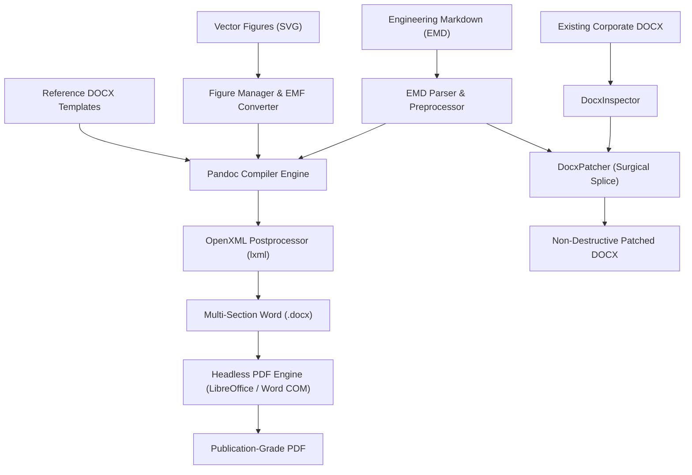

# EngDoc: Engineering Document Authoring and Publishing System

EngDoc is a local-first, offline engineering document authoring and publishing system that bridges the speed of Markdown, the mathematical rigor and layout flexibility of LaTeX, and the publishing ecosystem of Microsoft Word (`.docx`) and PDF.

---

## 1. System Architecture



### Core Design Principles
- **Separation of Concerns**: Strict boundary between Content (Markdown), Layout (EMD section directives), Presentation (Word template styles), and Publishing (headless compilers).
- **Non-Destructive Invariant**: Source files, templates, and corporate documents are never overwritten directly; outputs are generated as separate versioned artifacts.
- **Office 2013-2021 Compatibility**: 100% compliant OpenXML structures with native Word Math (`<m:oMath>`), vector metafile figures (EMF/PNG), and safe section boundaries (`<w:sectPr>`).
- **Offline / Local-First**: Zero cloud or CDN dependencies; all compilers, editors, preview engines, and tools run locally.

---

## 2. Quickstart & Installation

EngDoc requires **Python 3.12+** and is managed via [`uv`](https://docs.astral.sh/uv/).

```bash
# 1. Clone repository
git clone https://github.com/organization/EngDoc.git
cd EngDoc

# 2. Sync dependencies including CLI tools
uv sync --all-extras

# 3. Verify environment readiness
uv run engdoc doctor

# 4. Launch web workspace
uv run engdoc serve
```

The authoring interface will open automatically in your browser at `http://127.0.0.1:8000`.

---

## 3. Command-Line Interface (`engdoc`)

EngDoc includes a unified CLI for automation and headless continuous integration:

### System Diagnostics
```bash
uv run engdoc doctor
```
Checks status and versions of Pandoc, LibreOffice, Inkscape, and Word COM automation.

### Create a New Project Container
```bash
uv run engdoc new "Orbital Mechanics Spec" -d ENG-ORB-001 -r A -o projects/orbital.mdoc
```

### Headless Document Publishing (DOCX + PDF)
```bash
uv run engdoc build examples/satellite_thermal_spec.mdoc --format docx,pdf --output-dir dist/
```

### Inspect Existing Word Documents
```bash
uv run engdoc inspect corporate_standard.docx
```
Extracts outline headings (H1-H9), bookmark ranges, Content Controls (SDT), section geometries, and tables.

### Surgically Patch Word Documents
```bash
uv run engdoc patch base_spec.docx \
  --action INSERT_BEFORE \
  --anchor-type BOOKMARK \
  --anchor-name "BM_RESULTS" \
  --snippet "### 3.1 Empirical Telemetry Log\n\nSensor readings confirmed." \
  --output patched_spec.docx
```

---

## 4. Engineering Markdown (EMD) Syntax

EngDoc extends standard GitHub Flavored Markdown with engineering directives:

### Multi-Section Layouts & Continuous Columns
EngDoc supports arbitrary page orientations, margin overrides, and continuous multi-column breakouts on the same physical page:

```markdown
# 1. Executive Summary
Standard full-width single-column narrative.

@section
  type: continuous
  columns: 2
@end

### Key Performance Metrics
- Dynamic dual-column layout begins on the same page.

### Subsystem Verification
- Seamless column flow without premature page ejections.

@section
  type: continuous
  columns: 1
@end

# 2. Panoramic Schematics

@section
  orientation: landscape
  page: A4
  columns: 1
@end

Wide schematic diagram or extensive tabular matrix in landscape orientation.
```

### Native Word Equations (OMML)
Equations written in LaTeX syntax are converted directly into Microsoft Word native OMML equations (`<m:oMath>`):

$$
P_{\text{rad}} = \epsilon \sigma A \left( T_1^4 - T_2^4 \right)
$$

### Vector Figure Embedding & Management
```markdown
@figure FIG-001
  caption: "Satellite Power and Telemetry Bus Architecture"
  width: "150mm"
  alignment: center
@end
```
- **Sequential Gap-Filling**: Deleting an intermediate figure (e.g. `FIG-005` out of 10) reclaims its slot for the next imported figure before incrementing.
- **Direct 1-to-1 Replacement**: Select figure(s) and use **🔄 Replace Image(s)...** in the Figure Manager toolbar to replace image assets while preserving IDs, captions, dimensions, alignment, and markdown references.
- **Real-Time Live Preview**: Browser and HTML preview cache invalidation via dynamic query tokens (`?v={hash}`) ensures newly replaced figures render immediately.
- **Robust Sizing Calculation**: Safe integer dimension scaling prevents numeric overflow (`integer division result too large for a float`) on complex drawing extents.

### Surgical Word Section Patching
Inspect corporate Word documents and surgically replace entire sections or ranges without altering styles or headers:

```bash
# Surgical section replacement via CLI / API
uv run engdoc patch base_spec.docx \
  --action REPLACE \
  --anchor-type HEADING \
  --anchor-name "3. Thermal Design Requirements" \
  --scope complete_section \
  --snippet "## 3. Revised Thermal Requirements\n\nUpdated temperature ranges." \
  --output patched_spec.docx
```

---

## 5. Sample Engineering Project

A complete, production-grade sample project is included:
- **Archive**: [`examples/satellite_thermal_spec.mdoc`](file:///home/satish/Documents/Code/tools/EngDoc/examples/satellite_thermal_spec.mdoc)
- **Source Folder**: [`examples/satellite_thermal_spec/`](file:///home/satish/Documents/Code/tools/EngDoc/examples/satellite_thermal_spec/)
  - `manifest.yaml`: Project metadata and configuration.
  - `content/main.md`: Multi-section layout (Portrait A4 + Landscape A4 2-column) with radiative flux equations.
  - `figures/sensor_array.svg`: Standalone vector telemetry schematic.
  - `metadata/figures.yaml`: Figure registry with SHA-256 change tracking.

---

## 6. Running the Test Suite

```bash
# Run complete test suite (Unit & Integration)
uv run pytest -v

# Run code style and lint checks
uv run ruff check .
```
