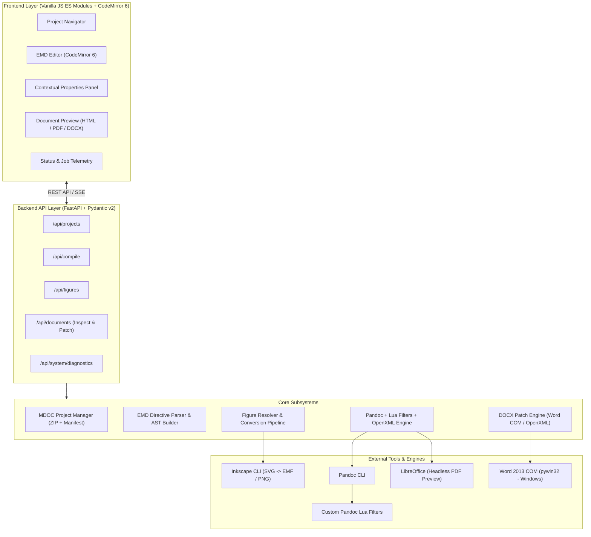

# EngDoc System Architecture

## 1. Executive Summary

EngDoc (Engineering Document Studio) is a local-first engineering document authoring and publishing system. It unites the speed and simplicity of Markdown authoring with the document-layout capabilities of LaTeX and the enterprise corporate publishing capabilities of Microsoft Word.

The system is designed with four strictly isolated concerns:
1. **Content**: Text, equations, tables, and figures authored in EMD (Engineering Markdown).
2. **Layout**: Orientation (portrait/landscape), paper sizes (A4/A3/Letter), margins, section breaks, and multi-column formats.
3. **Presentation**: Microsoft Word reference templates (`.docx`) containing corporate typography, styles, cover pages, headers, and footers.
4. **Publishing**: Multi-format publishing engine generating editable Word documents (`.docx`), vector-embedded PDFs, and fast in-browser HTML previews.

---

## 2. High-Level System Architecture

---

## 3. Subsystem Breakdown

### 3.1 Project Subsystem (`engdoc.project`)
- **Responsibility**: Manages `.mdoc` project packages (standard ZIP archives).
- **Invariants**:
  - Atomic saves: Always writes to a temporary staging file before replacing the target archive.
  - Safe extraction: Path traversal (`ZipSlip`) protection; rejects any entry resolving outside the project root.
  - Resource resolution: Resolves all asset paths relative to the project directory tree.

### 3.2 Markup & Directives Subsystem (`engdoc.markup`)
- **Responsibility**: Parses EMD documents, processes YAML frontmatter metadata, extracts layout directives (`@section`, `@layout`), figure declarations (`@figure`), and breaks (`@pagebreak`, `@sectionbreak`).
- **Invariants**:
  - Standard CommonMark compatibility: Plain text editors can read the document without syntax errors.
  - Authoritative document model: Maintains a structured AST representing sections, figures, and attributes.

### 3.3 Figure Subsystem (`engdoc.figures`)
- **Responsibility**: Maintains the project figure registry (`figures.yaml`), tracks vector sources (SVG, Draw.io), computes content hashes for modification detection, and drives format conversions (EMF for Office 2013, 300 DPI PNG as universal fallback).
- **Invariants**:
  - Source files are read-only; conversions are written to an isolated asset cache.
  - Figures in released DOCX documents are fully embedded.

### 3.4 Compiler Subsystem (`engdoc.compiler`)
- **Responsibility**: Orchestrates the multi-stage document generation pipeline:
  1. Resolves markdown content and linked figures.
  2. Synthesizes intermediate Pandoc AST with custom Lua filters.
  3. Executes Pandoc against selected reference `.docx` templates.
  4. Post-processes generated OpenXML (`lxml`) to inject Word section break properties (`w:sectPr`, `w:pgSz`, `w:pgMar`, `w:cols`).
  5. Renders optional PDF via LibreOffice headless or Word COM.

### 3.5 Document Inspection & Patching Subsystem (`engdoc.documents`)
- **Responsibility**: Inspects existing corporate Word documents (`.docx`), exposes document outlines (headings, bookmarks, content controls), and performs targeted insertions (`INSERT BEFORE`, `INSERT AFTER`, `REPLACE`, `APPEND`).
- **Invariants**:
  - Non-destructive: Original documents are never overwritten directly; outputs are written to timestamped files.
  - High fidelity: On Windows, uses Word 2013 COM automation to maintain complex styling, macros, and existing headers/footers; on Linux, uses scoped OpenXML DOM manipulation.

---

## 4. Architectural Mitigations for Technical Risks

### Risk 1: Mixed Orientations and Multi-Column Layouts in Word (DOCX)
- *Challenge*: Pandoc converts Markdown to a single continuous body section by default. It does not natively construct alternating portrait/landscape or multi-column sections from Markdown blocks.
- *Solution*:
  1. EMD parses `@section orientation: landscape ... @end` and emits custom raw OpenXML or distinct Pandoc `Div` blocks with layout attributes.
  2. A Pandoc Lua filter converts these Divs into Word section boundary paragraphs containing `<w:pPr><w:sectPr>`.
  3. A Python OpenXML post-processor verifies that the terminal section properties and intermediate paragraph-level section properties accurately encode page dimensions (`w:w`, `w:h`, `w:orient`) and column distributions (`w:cols`).

### Risk 2: High-Fidelity Modification of Existing Corporate DOCX Documents
- *Challenge*: Parsing an entire complex corporate document through Python-docx and re-saving it often discards unsupported OpenXML tags (e.g. customized headers/footers, drawing canvases, nested fields).
- *Solution*:
  1. Bookmark-anchored target identification: Word bookmarks provide stable, identifiable ranges.
  2. On Windows: Delegate patch operations to Microsoft Word 2013 COM (`pywin32`). Word COM opens the document in headless mode, navigates to the Bookmark range, executes Range replacement/insertion with the compiled EMD snippet, and preserves all surrounding document elements natively.
  3. On Linux / Non-COM environments: Perform surgical XML manipulation directly on `document.xml` using `lxml`, altering only the child elements within the identified bookmark or heading scope without re-serializing unrelated parts.

### Risk 3: Vector Figure Compatibility with Office 2013
- *Challenge*: Word 2013 does not support SVG images. Direct SVG embedding results in blank boxes or corrupted package errors.
- *Solution*:
  1. The figure subsystem maintains source files in SVG format.
  2. Assets are converted to EMF (Enhanced Metafile) via Inkscape CLI (`--export-type=emf`).
  3. If EMF conversion fails or Inkscape is not present, generate high-resolution PNG (300+ DPI) with physical dimension metadata (`w:extent` in OpenXML) so visual resolution is never compromised.
